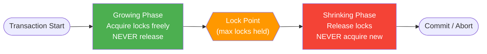
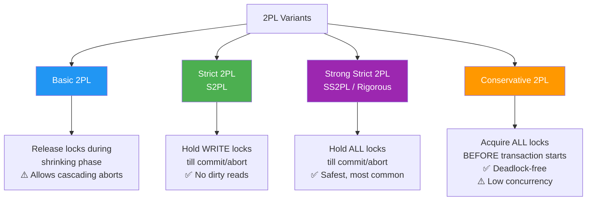
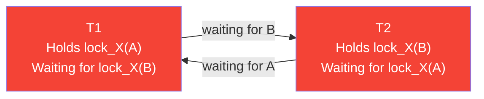
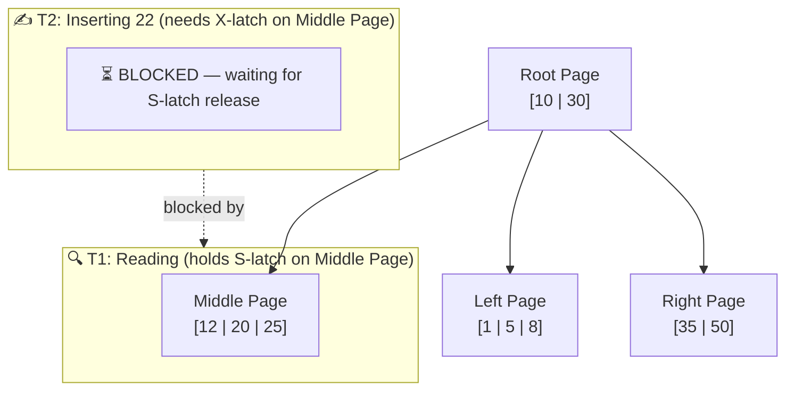
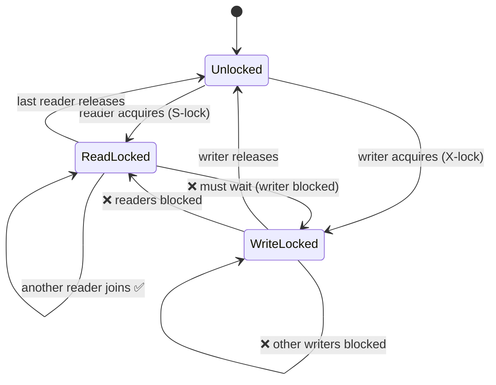
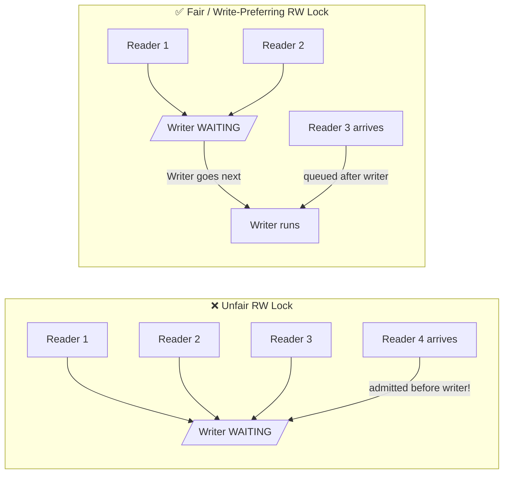

---
tags:
  - database-internals
  - concurrency-control
  - locking
  - two-phase-locking
  - latches
  - readers-writer-lock
date_created: 2026-08-23
last_modified: 2026-08-24
---

# 🔒 Lock-Based Concurrency Control

> [!info] **Overview**
> Lock-based concurrency control is the most widely used mechanism to enforce **isolation** in databases. Transactions acquire locks on data items before accessing them, ensuring that conflicting operations do not execute simultaneously.
>
> This note covers three core primitives:
> - **Two-Phase Locking (2PL)** — transaction-level protocol for serializability
> - **Latches** — lightweight, short-lived engine-level locks for internal structures
> - **Readers-Writer Lock** — shared/exclusive access pattern for concurrent reads

---

## 🔑 Lock Types (Fundamentals)

Before diving in, understand the two basic lock modes:

| Lock Mode | Symbol | Who can hold it simultaneously? | Purpose |
|-----------|--------|--------------------------------|---------|
| **Shared (S)** | Read lock | Multiple transactions | Reading data |
| **Exclusive (X)** | Write lock | Only ONE transaction | Writing data |

> [!info] **These two modes — S and X — are the building blocks for all three mechanisms in this note.**
> - **2PL** uses them as *transaction-level* locks: S-lock on reads, X-lock on writes, governed by the two-phase protocol.
> - **Latches** use them as *engine-level* guards on in-memory pages: S-latch for safe concurrent traversal, X-latch for structural mutations like splits.
> - **Readers-Writer Lock** is the *direct implementation* of this exact model — a Read Lock is an S-lock, a Write Lock is an X-lock.

**Compatibility Matrix:**

| | S (held) | X (held) |
|---|---|---|
| **S (requested)** | ✅ Compatible | ❌ Conflict |
| **X (requested)** | ❌ Conflict | ❌ Conflict |

---

## 1️⃣ Two-Phase Locking (2PL)

> [!info] **Definition**
> A protocol that guarantees **serializability** (conflict-serializable schedules) by dividing a transaction's lifetime into exactly two phases:
> - **Growing Phase** — locks are only acquired, never released.
> - **Shrinking Phase** — locks are only released, never acquired.

### 📐 The Protocol



> [!note] **The Lock Point**
> The moment a transaction holds its **maximum number of locks**. This is the logical serialization point — the order of lock points defines the equivalent serial schedule.

### 🔄 Variants of 2PL



> [!example] **Example: Bank Transfer with Strict 2PL**
> ```
> T1: Transfer $100 from Account A → Account B
> T2: Audit both accounts (read A and B)
> ```
>
> ```
> Timeline:
>
> T1: lock_X(A) ──── lock_X(B) ──────────────── write(A) ── write(B) ── COMMIT ── unlock(A) ── unlock(B)
>                                                                                     ↑ Strict: release only at commit
>
> T2:             lock_S(A)         [BLOCKED on B]                                            lock_S(B) ── read(A,B) ── COMMIT
>                    ↑
>          T2 reads a consistent
>          snapshot (no dirty read)
> ```

> [!example] **Java: Simulating 2PL logic with `ReentrantLock`**
> ```java
> public class TwoPhaseTransfer {
>     private final ReentrantLock lockA = new ReentrantLock();
>     private final ReentrantLock lockB = new ReentrantLock();
>
>     public void transfer(Account from, Account to, BigDecimal amount) {
>         // GROWING PHASE — acquire all needed locks
>         lockA.lock();
>         lockB.lock();
>
>         try {
>             // Lock Point reached — all locks held
>             from.debit(amount);
>             to.credit(amount);
>
>             // SHRINKING PHASE — release at commit (Strict 2PL)
>         } finally {
>             lockB.unlock();
>             lockA.unlock();
>         }
>     }
> }
> ```

### ⚠️ Deadlocks in 2PL

2PL is vulnerable to **deadlocks** when transactions wait for each other's locks in a cycle.



**Deadlock handling strategies:**

| Strategy | How | Trade-off |
|----------|-----|-----------|
| **Detection** (Wait-For Graph) | Detect cycles, abort a victim | Reactive; some wasted work |
| **Prevention (Wait-Die)** | Older txn waits; younger aborts | More aborts for young txns |
| **Prevention (Wound-Wait)** | Older txn preempts younger | Younger txns often restarted |
| **Timeout** | Abort if waiting too long | Simple but imprecise |
| **Lock ordering** | Always acquire locks in a fixed order | Requires discipline; eliminates cycles |

---

## 2️⃣ 🔩 Latches

> [!info] **Definition**
> Latches are **lightweight, short-lived mutual exclusion primitives** used internally by the database **storage engine** (not by user transactions). They protect **in-memory data structures** like B-tree pages, buffer pool frames, and log buffers from concurrent modification.

### 🆚 Locks vs Latches

| Property | Locks (Transactions) | Latches (Engine) |
|----------|----------------------|-----------------|
| **Duration** | Entire transaction (seconds to minutes) | Microseconds to milliseconds |
| **Managed by** | Lock Manager | Storage Engine code |
| **Deadlock detection** | Yes (Wait-For Graph) | No — use lock ordering |
| **Granularity** | Row, page, table | B-tree node, buffer frame |
| **Undo/Redo needed?** | Yes | No |
| **User visible?** | Yes (e.g., `SELECT FOR UPDATE`) | No |

### 🌳 Latches in B-Tree Traversal

> [!question] **Why do B-trees need latches?**
> While one thread traverses a B-tree to read a value, another may be inserting and **splitting a page**, restructuring the tree. Without latches, a reader can see a half-split, corrupt node.



> [!example] **Latch Crabbing / Lock Coupling (safe B-tree traversal)**
> A technique to safely traverse B-trees without holding all latches at once:
>
> ```
> To SEARCH for key K:
>   1. Acquire S-latch on root
>   2. Acquire S-latch on child
>   3. Release S-latch on root  ← "crab" downward
>   4. Acquire S-latch on grandchild
>   5. Release S-latch on child
>   ... repeat until leaf is found
> ```
>
> ```
> To INSERT key K:
>   1. Acquire X-latch on root
>   2. Acquire X-latch on child
>   3. If child is SAFE (won't split), release parent's X-latch
>   4. Continue down...
>   A node is SAFE if:
>     - On insert: node has room (not full)
>     - On delete: node is more than half-full
> ```


> [!example] **Java: Latch with `synchronized` (simplified)**
> ```java
> public class BTreePage {
>     private final Object latch = new Object();
>     private final List<Integer> keys = new ArrayList<>();
>
>     // S-latch equivalent — multiple readers OK with ReadWriteLock
>     public int search(int key) {
>         synchronized (latch) {  // simplified; use ReadWriteLock for real S/X
>             return Collections.binarySearch(keys, key);
>         }
>     }
>
>     // X-latch — exclusive write
>     public void insert(int key) {
>         synchronized (latch) {
>             int pos = Collections.binarySearch(keys, key);
>             keys.add(pos < 0 ? ~pos : pos, key);
>         }
>     }
> }
> ```

---

## 3️⃣ 📖 Readers-Writer Lock (RW Lock)

> [!info] **Definition**
> A synchronization primitive that allows **multiple concurrent readers** OR **one exclusive writer** at a time — but never both simultaneously. Optimizes for the common case where reads greatly outnumber writes.

### 📊 Access Rules



> [!example] **Java: `ReentrantReadWriteLock`**
> ```java
> public class SharedCache {
>     private final ReadWriteLock rwLock = new ReentrantReadWriteLock();
>     private final Lock readLock  = rwLock.readLock();
>     private final Lock writeLock = rwLock.writeLock();
>     private final Map<String, String> cache = new HashMap<>();
>
>     // Many threads can call this simultaneously
>     public String get(String key) {
>         readLock.lock();
>         try {
>             return cache.get(key);
>         } finally {
>             readLock.unlock();
>         }
>     }
>
>     // Only ONE thread at a time; blocks all readers too
>     public void put(String key, String value) {
>         writeLock.lock();
>         try {
>             cache.put(key, value);
>         } finally {
>             writeLock.unlock();
>         }
>     }
> }
> ```

> [!example] **Concurrent read scenario**
> ```
> Thread 1: readLock() ──────────────── readLock.unlock()
> Thread 2:    readLock() ─────────────────── readLock.unlock()
> Thread 3:       readLock() ──────────────────── readLock.unlock()
>
>                ↑ All three run in parallel ✅
>
> Thread 4 (writer):          [BLOCKED]──── writeLock() ── writeLock.unlock()
>                                            ↑ waits for all readers to finish
> ```

### ⚠️ Writer Starvation

> [!warning] **Writer Starvation Problem**
> In a busy read-heavy system, a writer can be **starved indefinitely** if new readers keep arriving before existing readers finish.
>
> **Solution:** Use a **fair** or **write-preferring** RW lock:
> - Once a writer is waiting, **no new readers** are admitted
> - Java's `new ReentrantReadWriteLock(true)` enables **fair mode**



> [!example] **Fair RW Lock in Java**
> ```java
> // Pass 'true' to enable fair ordering
> private final ReadWriteLock rwLock = new ReentrantReadWriteLock(true);
> ```

### 🔄 RW Lock in Databases

RW locks appear throughout the database engine stack:

| Component | Read Lock | Write Lock |
|-----------|-----------|------------|
| **Buffer Pool Frame** | SELECT reading a page | Page being evicted/flushed |
| **B-Tree Page (latch)** | Traversal / point lookup | Splits, merges, inserts |
| **Schema** | All DML queries | `ALTER TABLE` |
| **WAL (Write-Ahead Log)** | Recovery reads | Log appends |
| **Table-level** | `SELECT` (if no row locks) | `DROP TABLE`, bulk load |

---

## 📊 TL;DR — Summary Comparison

| | **2PL** | **Latches** | **RW Lock** |
|---|---|---|---|
| **Used by** | Transactions (user-level) | Storage engine (internal) | Both (general pattern) |
| **Duration** | Entire transaction | Microseconds | Varies |
| **Deadlock possible** | ✅ Yes | ❌ No (use ordering) | ⚠️ Possible |
| **Guarantees** | Serializability | Page/structure integrity | Concurrent reads |
| **Granularity** | Row, page, table | In-memory page/frame | Any shared resource |
| **User visible?** | Yes | No | Sometimes |

---

## 🔗 Related Topics

- [[Optimistic and Pessimistic Locks]]
- [[MVCC – Multi-Version Concurrency Control]]
- [[Transaction Isolation Levels]]
- [[Deadlocks and Prevention]]
- [[B-Tree Internals]]
- [[Buffer Pool Management]]
