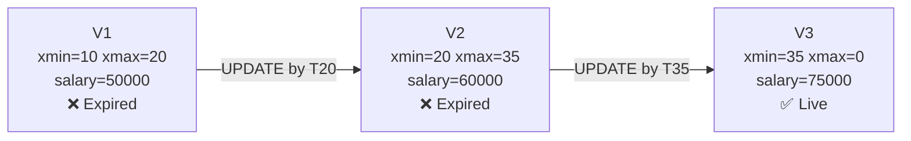
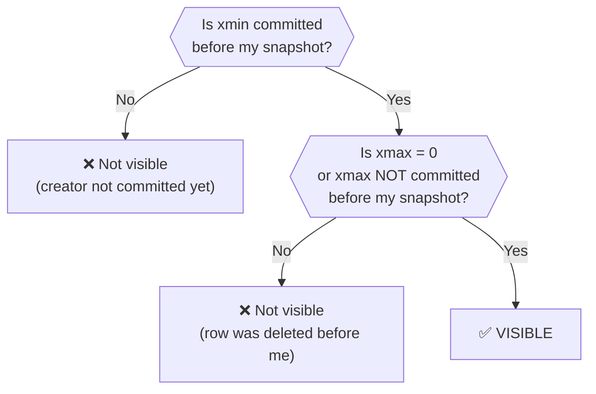
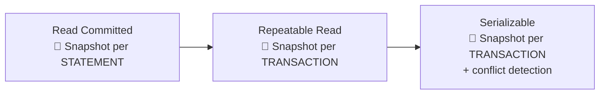
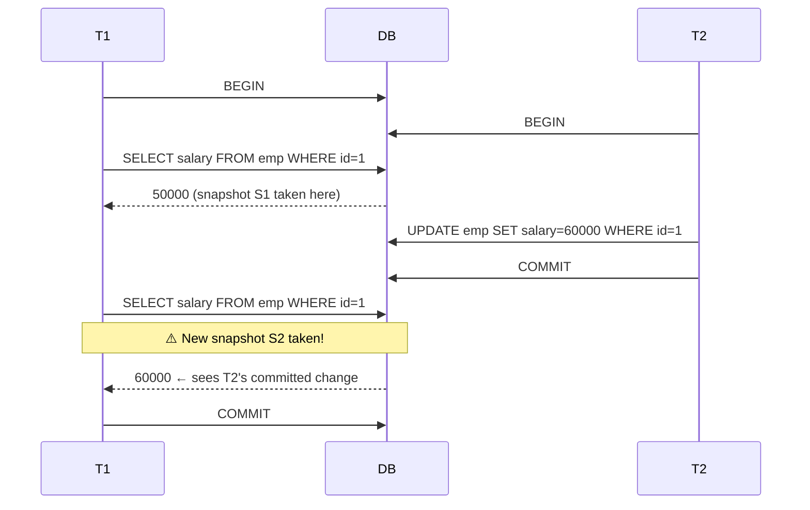
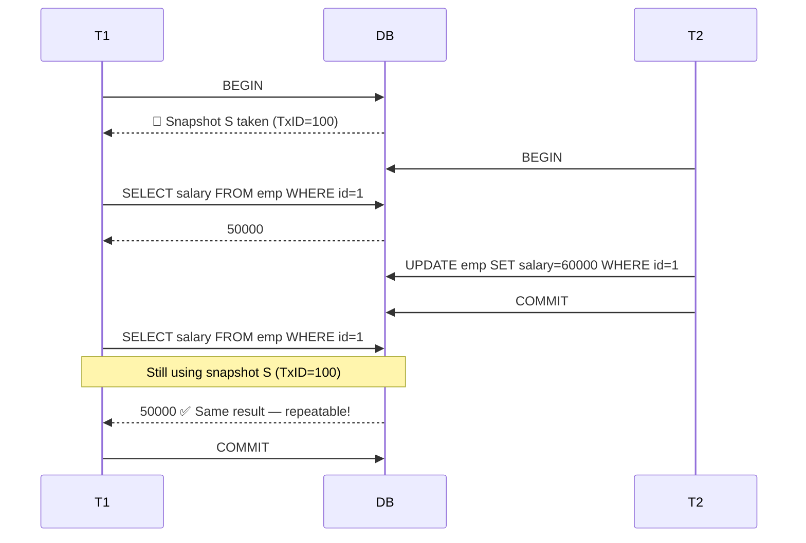
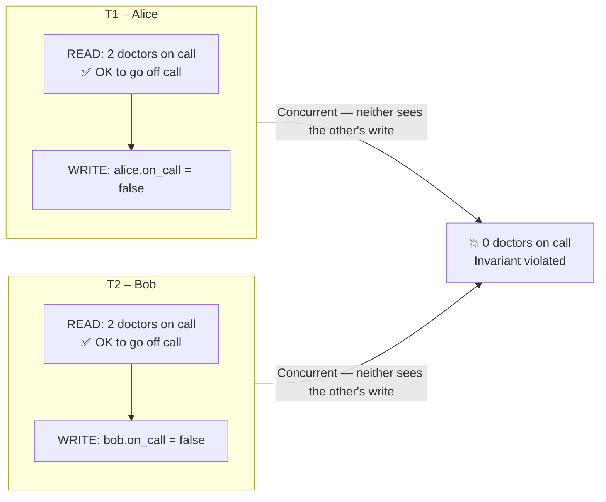
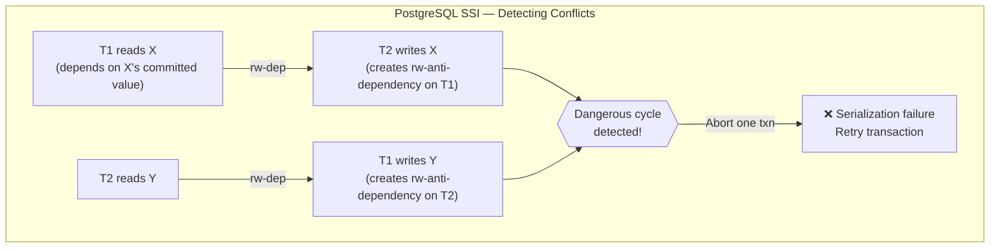
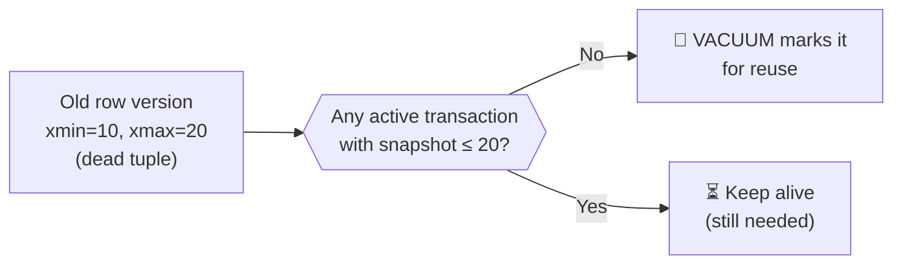

---
tags:
  - database-internals
  - concurrency-control
  - mvcc
  - isolation-levels
  - transactions
date_created: 2026-08-24
last_modified: 2026-08-24
---

# 🕰️ MVCC – Multi-Version Concurrency Control

> [!info] **The Core Idea**
> Instead of locking a row so only one transaction can touch it at a time, MVCC keeps **multiple versions** of the same row alive simultaneously. Each transaction sees a **consistent snapshot** of the database as it existed at a specific point in time.
>
> **The golden rule of MVCC:**
> > 🔵 **Readers never block Writers. Writers never block Readers.**

---

## 🧱 How MVCC Stores Versions

Every row in an MVCC database carries hidden metadata columns tracking its lifetime:

| Hidden Column | Meaning |
|---------------|---------|
| `xmin` | Transaction ID (TxID) that **created** this version |
| `xmax` | TxID that **deleted or updated** this version (`0` = still alive) |
| `ctid` | Physical location of this row version (PostgreSQL) |

> [!example] **Visualising a version chain**
>
> ```
> Initial state — Alice's salary is 50,000
> ┌──────────────────────────────────────────┐
> │  xmin=10  xmax=0   salary=50000  (LIVE)  │  ← version V1
> └──────────────────────────────────────────┘
>
> T2 (TxID=20) runs: UPDATE salary = 60000
> ┌────────────────────────────────────────────┐
> │  xmin=10  xmax=20  salary=50000  (EXPIRED) │  ← version V1 (old)
> └────────────────────────────────────────────┘
> ┌──────────────────────────────────────────┐
> │  xmin=20  xmax=0   salary=60000  (LIVE)  │  ← version V2 (new)
> └──────────────────────────────────────────┘
> ```
>
> Old version V1 is **not deleted immediately** — it stays until no transaction needs it anymore (cleaned up by VACUUM in PostgreSQL).



### 👁️ Visibility Rule

> [!info] **A version V is visible to transaction T if:**
> 1. `V.xmin` is **committed** and `V.xmin < T.snapshot_time` *(version was created before my snapshot)*
> 2. `V.xmax` is **0** (never deleted) **OR** `V.xmax` is not yet committed at T's snapshot time *(version wasn't deleted before my snapshot)*



---

## 🎯 How MVCC Works Under Each Isolation Level

The **key variable** that changes across isolation levels is:
> 🔑 **When is the snapshot taken?**



---

### 🟡 Read Uncommitted

> [!note]
> In pure MVCC databases (e.g., **PostgreSQL**), Read Uncommitted behaves **identically to Read Committed** — because MVCC *structurally cannot* serve uncommitted versions (there's no "dirty" pointer to follow). Every version you read has a committed `xmin`.
>
> MySQL InnoDB technically can serve dirty reads here, but this level is almost never used in practice.

| Anomaly | Status |
|---------|--------|
| Dirty Read | ✅ Prevented (by MVCC structure) |
| Non-Repeatable Read | ❌ Possible |
| Phantom Read | ❌ Possible |
| Write Skew | ❌ Possible |

---

### 🟠 Read Committed

> [!info] **Snapshot taken at the start of each STATEMENT.**
> Every new query inside the same transaction gets a **fresh snapshot**, so it can see data committed by other transactions between statements.



> [!warning] **Non-Repeatable Read** — T1 reads `50000` then `60000` in the same transaction. The same query yields different results.

> [!example] **When Read Committed is the right choice**
> ```sql
> -- Session 1 (report query that runs for 10 seconds)
> BEGIN;
> SELECT COUNT(*) FROM orders WHERE status = 'pending';  -- snapshot taken HERE
> -- ... 5 seconds later ...
> SELECT SUM(amount) FROM orders WHERE status = 'pending'; -- NEW snapshot
> -- Session 2 commits new orders between these two queries
> -- The two queries may be inconsistent — acceptable for dashboards, not for accounting
> COMMIT;
> ```

---

### 🟢 Repeatable Read

> [!info] **Snapshot taken once at the start of the TRANSACTION.**
> All reads throughout the transaction see the **same frozen snapshot**, regardless of what other transactions commit in the meantime.



> [!note] **PostgreSQL goes further than the SQL standard here.**
> The SQL standard says Repeatable Read still allows Phantom Reads. But PostgreSQL's snapshot-based RR **also prevents phantom reads** — because the snapshot was frozen, newly inserted rows (with `xmin > snapshot`) are simply invisible.

| Anomaly | SQL Standard RR | PostgreSQL RR |
|---------|----------------|--------------|
| Dirty Read | ✅ Prevented | ✅ Prevented |
| Non-Repeatable Read | ✅ Prevented | ✅ Prevented |
| Phantom Read | ❌ Possible | ✅ Prevented |
| Write Skew | ❌ Possible | ❌ Possible |

#### ⚠️ Write Skew — The Remaining Anomaly at RR

> [!warning] **Write Skew** is a subtle anomaly that MVCC Repeatable Read cannot prevent.
>
> ```
> Invariant: At least one doctor must be on call at all times.
> Current state: Alice (on_call=true), Bob (on_call=true)
>
> T1 (Alice going off call):           T2 (Bob going off call):
>   SELECT COUNT(*) WHERE on_call=true   SELECT COUNT(*) WHERE on_call=true
>   → sees 2 ✅ safe to proceed          → sees 2 ✅ safe to proceed
>   UPDATE alice SET on_call=false       UPDATE bob SET on_call=false
>   COMMIT                               COMMIT
>
> Result: BOTH doctors off call — invariant violated! 💥
> ```
>
> Each transaction read a consistent snapshot and made a locally-valid decision. But the **combined effect** broke the invariant. Neither saw the other's write.



---

### 🔴 Serializable (SSI — Serializable Snapshot Isolation)

> [!info] **Snapshot taken at transaction start + runtime conflict detection.**
> PostgreSQL implements **SSI (Serializable Snapshot Isolation)** — a non-blocking algorithm that detects dangerous "rw-anti-dependency" cycles between transactions and aborts one if a serialization conflict is found.
>
> MySQL InnoDB uses **locking** (not SSI) at Serializable — it adds gap locks and next-key locks, effectively blocking concurrent writes to prevent phantoms.



> [!example] **The doctor on-call scenario — now fixed at Serializable**
> ```sql
> BEGIN TRANSACTION ISOLATION LEVEL SERIALIZABLE;
>
> -- T1: Alice checking doctors on call
> SELECT COUNT(*) FROM doctors WHERE on_call = true;  -- reads: 2
> UPDATE doctors SET on_call = false WHERE name = 'Alice';
>
> COMMIT;
> -- If T2 ran concurrently and created a conflict cycle,
> -- PostgreSQL detects it and aborts one with:
> -- ERROR: could not serialize access due to concurrent update
> ```

| Anomaly | Serializable (SSI) |
|---------|-------------------|
| Dirty Read | ✅ Prevented |
| Non-Repeatable Read | ✅ Prevented |
| Phantom Read | ✅ Prevented |
| Write Skew | ✅ Prevented |

---

## 🧹 MVCC Housekeeping — Version Cleanup

Keeping old versions has a cost. Databases must clean them up when no active transaction needs them anymore.



| Database | Cleanup Mechanism | Notes |
|----------|------------------|-------|
| **PostgreSQL** | `VACUUM` / `autovacuum` | Dead tuples reclaimed; table bloat if vacuum lags |
| **MySQL InnoDB** | Purge thread | Undo log segments purged in background |
| **Oracle** | Undo tablespace | Circular reuse; old reads fail with `ORA-01555` if undo is overwritten |

> [!warning] **Long-running transactions are MVCC's enemy.**
> A transaction that stays open for hours forces the DB to keep **all versions** created during that window alive — causing table bloat, undo log growth, and performance degradation.

---

## 📊 TL;DR — MVCC Across Isolation Levels

| Isolation Level | Snapshot Taken | Dirty Read | Non-Repeatable Read | Phantom Read | Write Skew |
|----------------|----------------|-----------|-------------------|-------------|------------|
| Read Uncommitted | Per statement (PG: same as RC) | ✅ | ❌ | ❌ | ❌ |
| Read Committed | Per **statement** | ✅ | ❌ | ❌ | ❌ |
| Repeatable Read | Per **transaction** | ✅ | ✅ | ✅ (PG) / ❌ (standard) | ❌ |
| Serializable | Per transaction + SSI | ✅ | ✅ | ✅ | ✅ |

> [!tip] **Quick rule of thumb**
> - Default for most apps → **Read Committed** (PostgreSQL default)
> - Financial / analytical queries needing consistent view → **Repeatable Read**
> - Critical invariants across multiple rows → **Serializable**

---

## 🔗 Related Topics

- [[Optimistic and Pessimistic Locks]]
- [[Lock-Based Concurrency Control]]
- [[Transaction Isolation Levels]]
- [[Deadlocks and Prevention]]
- [[Write-Ahead Logging (WAL)]]
