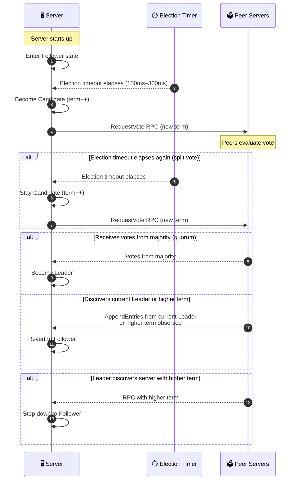
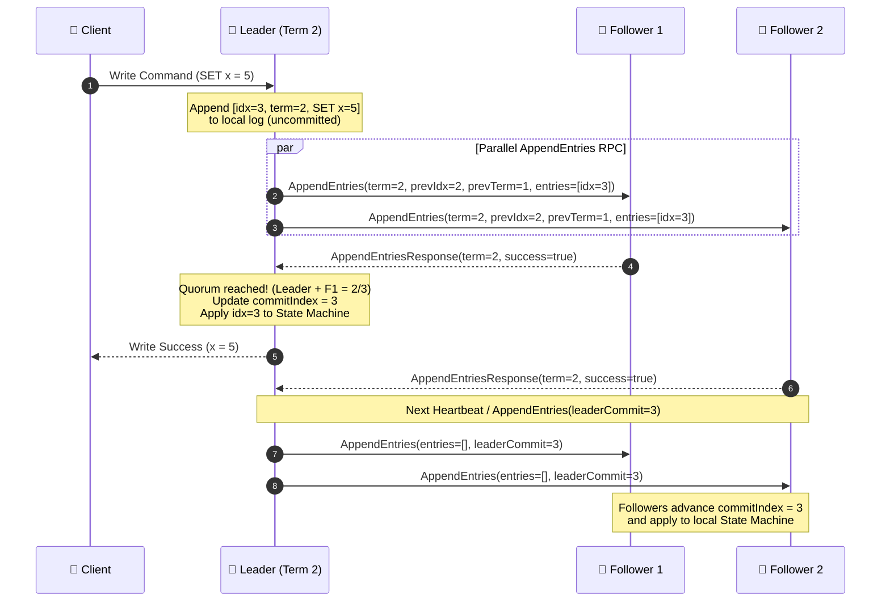

---
tags:
  - distributed-systems
  - consensus
  - raft
  - algorithms
  - system-design
date_created: 2026-10-10
last_modified: 2026-10-10
links: " https://thesecretlivesofdata.com/raft/"
---

> [!todo] Key Concepts to Master
> - [ ] Replicated State Machine (RSM) architecture & the problem of distributed consensus
> - [ ] Server states (`Follower`, `Candidate`, `Leader`) and Logical Clocks (`Terms`)
> - [ ] Leader Election & Randomized Election Timeouts (solving split votes)
> - [ ] Log Replication (`AppendEntries` RPC, `commitIndex`, `lastApplied`, `nextIndex`, `matchIndex`)
> - [ ] Safety Guarantees (Election Restriction, Commit Rule for previous terms, Log Matching Property)
> - [ ] Linearizable Reads (`ReadIndex` & `LeaseRead`), Log Compaction (Snapshotting), and Pre-Vote

# What is Raft?

**Raft** (*"Reliable, Replicated, Redundant, And Fault-Tolerant"*) is a distributed consensus algorithm designed by **Diego Ongaro and John Ousterhout** at Stanford University (2014) as an **understandable alternative to Paxos family of algorithms**.

Raft offers a generic way to distribute a **state machine** across a **cluster** of computing systems, ensuring that each node in the cluster agrees upon the same series of state transitions.

Locally, participants store a log containing the sequence of commands executed by the state machine. Since inputs that processes receive are identical and logs contains the same  commands in the same order, applying these commands to the state machine guarantees the same output. Raft simplifies consensus by making the concept of leader a first-class citizen. A leader is used to coordinate state machine manipulation and replication. A single leader emerges from replicas, makes atomic decisions, and establishes the message order.

**Real-world systems powered by Raft:**
- ☸️ **etcd** (Kubernetes control plane backing store)
- 🪳 **CockroachDB** & **TiKV** (Multi-Raft distributed SQL databases)
- 📨 **Apache Kafka (KRaft)** (Replaced ZooKeeper for metadata management)
- 🔐 **HashiCorp Consul** & **Vault** (Service discovery & secret management)
- 🐇 **RabbitMQ Quorum Queues** & **Neo4j Causal Clustering**


> [!question] Why not just use Paxos?
> Multi-Paxos is notoriously difficult to understand and even harder to engineer in production:
> 1. **Single-decree Paxos** only agrees on a single value; combining instances into a log (**Multi-Paxos**) has no single universally agreed-upon specification.
> 2. Paxos uses a **symmetric, peer-to-peer** design where any node can propose values at any index, leaving gaps in the log that must be reconciled later.
>
> **Raft's Solution – Problem Decomposition & Strong Leadership:**
> Raft decomposes consensus into three distinct sub-problems:
> 1. **🗳️ Leader Election:** Electing a single coordinator when an existing leader fails.
> 2. **📜 Log Replication:** The leader accepts client commands and forces all followers' logs to match its own.
> 3. **🛡️ Safety:** Ensuring that if any state machine applies a specific log entry at a given index, *no other state machine will ever apply a different log entry for that same index*.

| ✅ Pros of Raft | ❌ Cons of Raft |
| :--- | :--- |
| **Understandable & Decomposable:** Clear separation of election, replication, and safety | **Single Leader Bottleneck:** All write traffic must flow through the single elected leader |
| **Strong Leader Model:** Logs only flow in one direction (`Leader → Followers`), simplifying conflict resolution | **Network Jitter Sensitivity:** Brief asymmetric network partitions can trigger disruptive elections without `Pre-Vote` |
| **Deterministic Quorum Safety:** Tolerates up to $f$ failures with $2f + 1$ nodes (no split-brain) | **No Byzantine Fault Tolerance (BFT):** Assumes fail-stop (crash-recovery) model, not malicious nodes |

---
# Raft Server States

At any given time, every Raft server is in **one of three states**:

![[raft_server_states.svg]]
## Leader

- Raft achieves consensus via an elected leader.
- Handles all client write requests, if a client contacts a Follower, the Follower redirects it to the Leader.
- Replicates log entries to Followers and sends periodic **Heartbeats** (empty `AppendEntries` RPCs) to maintain authority.
- The Leader is elected for a period called a *term*. Each *term* is identified by a monotonically increasing number.
- A new leader is elected if the current one crashes, becomes unresponsive, or is suspected by other nodes to have failed, which can happen because of network partitions and message delays.

## Candidate

- An intermediate state used to elect a new Leader.
- Leadership is a temporary condition, and any participant can take this role.
- When a Follower's **election timeout** elapses without hearing a heartbeat from a valid Leader, the Follower first has to transition into a Candidate state to become a Leader, and attempt to collect a majority of votes.
- If a Candidate neither wins or loses the election, ie, when the vote is split between multiple Candidates and none of them has a majority of votes, the new *term* is slated and election restarts.

## Follower

- Completely passive participant that persists log entries; issues no RPCs on its own.
- Simply responds to incoming `AppendEntries` requests from Leader and `RequestVote` requests from Candidates RPCs.
- All servers boot up as Followers.




---
# How Terms Work as a Logical Clock (Fencing Token)?

- Raft divides time into **Terms** of arbitrary length, numbered with consecutive integers ($1, 2, 3, \dots$).
- A **Term** is an arbitrary period of time on the server for which a new leader needs to be elected.
- Each **Term** begins with an **election**, in which one or more candidates attempt to become Leader.
- If a candidate wins the election, it serves as the sole Leader for the rest of that term.
- If a **split vote** occurs, the term ends with **no leader**, and a new term ($T+1$) begins shortly thereafter.
- **Rule of Terms:** Every RPC includes the sender's `currentTerm`.
	- If a server's `currentTerm < incomingTerm`, it updates `currentTerm = incomingTerm` and **immediately reverts to Follower**.
	- If a server receives a request with `incomingTerm < currentTerm`, it **rejects the request immediately** (fencing off stale/zombie leaders!).

![[raft_terms.svg]]

---

# Leader Election

- When the existing Leader fails or when the algorithm initializes, a new Leader needs to be elected. Each *term* starts with a Leader election in the cluster.
- If the election is completed successfully (i.e. a single Leader is elected) the term keeps going with normal operations orchestrated by the new Leader.
- If the election is a failure, a new *term* starts, with a new election.
- A Leader election is started by a _Candidate_ server.

When a Follower receives no communication by the Leader over a period called the **election timeout**, so it assumes there is no acting leader anymore:

1. **Increment Term:** Follower increments its term counter, `currentTerm` ($T \leftarrow T + 1$).
2. **Transition to Candidate:** Changes state from `Follower` to `Candidate`.
3. **Vote for Self:** Votes for itself (`votedFor = selfId`) and persists state to disk.
4. **Reset Election Timer:** Picks a new **randomized election timeout** (typically between `150ms` and `300ms`).
5. **Broadcast `RequestVote` RPCs:** Sends `RequestVote` RPCs in parallel to all other nodes in the cluster requesting their vote. A server will vote only once per term, on a first-come-first-served basis.

>[!info]
> Raft uses a **heartbeat mechanism** to trigger leader election. As long as a Leader sends periodic heartbeats (`AppendEntries` RPC with empty log entries) faster than the **election timeout**, Followers remain Followers.


## Three Possible Election Outcomes

1. **Wins the Election:**
   - Receives votes from a **majority (quorum)** of nodes in the full cluster: $\lfloor N / 2 \rfloor + 1$ (e.g., 3 out of 5 nodes).
   - Transitions to `Leader` and immediately broadcasts **heartbeat** (`AppendEntries`) messages to all servers to establish authority and prevent new elections.

2. **Another Server Establishes Leadership:**
   - While waiting for votes, the Candidate receives an `AppendEntries` RPC from another server claiming to be Leader.
   - If the Leader's term $\ge$ the Candidate's `currentTerm`, the Candidate recognizes the Leader as legitimate and returns to `Follower` state.

3. **Split Vote (No Winner):**
   - Multiple Followers become Candidates simultaneously, splitting the votes so no Candidate reaches a majority.
   - Each Candidate's election timer eventually expires, incrementing the term ($T + 1$) and starting a new election round.

> [!question] How does Raft prevent infinite Split Votes?
> By using **Randomized Election Timeouts** (e.g., uniformly chosen between `150ms` and `300ms`).
> In almost all cases, one server will time out first, win the election, and send heartbeats *before* the other servers' timers expire. Even if a split vote happens, each candidate re-randomizes its timer for the next round, resolving the tie within a few milliseconds.

> [!note] The Timing Inequality Requirement
> Raft's liveness depends on the following timing inequality:
> $$\text{broadcastTime} \ll \text{electionTimeout} \ll \text{MTBF}$$
> - **$\text{broadcastTime}$ (`0.5ms – 20ms`):** Average time it takes a server to send RPCs in parallel to every node and receive responses (plus disk flush).
> - **$\text{electionTimeout}$ (`150ms – 500ms`):** Must be at least 10× the `broadcastTime` so leaders can reliably send heartbeats before followers time out.
> - **$\text{MTBF}$ (Mean Time Between Failures, `months`):** Average time between single-server crashes.


---

# Log Replication

The Leader is responsible for the log replication. Once a Leader is elected, it begins accepting client requests. Each client request contains a command to be executed by the Replicated State Machines in the cluster.

## Structure of a Log Entry

Every entry in the Raft log stores three pieces of information:
1. **`index`:** 1-based position of the entry in the log.
2. **`term`:** The logical term number when the entry was created by the Leader.
3. **`command`:** The state machine instruction (e.g., `SET x = 5`).

![[raft_committed_entries.svg]]

## The Replication Pipeline

1. **Local Append:** Leader appends the command to its own log as a new uncommitted entry and flushes to disk (`WAL`).
2. **Broadcast `AppendEntries`:** Leader issues `AppendEntries` RPCs in parallel to all Followers. If a Follower crashes or packets are lost, the Leader **retries `AppendEntries` indefinitely** (even after responding to the client) until all Followers eventually store all log entries.
3. **Commit on Majority (Quorum):** Once the entry has been safely replicated on a **majority of servers**, the Leader marks the entry as **committed** (`commitIndex` advances). This event also commits all previous entries in the leader's log
4. **Apply & Respond:** The Leader applies the entry to its local **State Machine** (`lastApplied` advances) and returns the execution result to the Client.
5. **Propagate `commitIndex`:** The Leader includes the highest committed index (`leaderCommit`) in all future `AppendEntries` RPCs (including heartbeats) so Followers can also apply the committed entry to their own state machines.




## The Log Matching Property

Raft maintains a critical invariant across all logs in the cluster known as the **Log Matching Invariant Property**:
1. If two entries in different logs have the **same index and same term**, then they store the **exact same command**.
2. If two entries in different logs have the **same index and same term**, then the logs are **identical in all preceding entries** ($1 \dots \text{index}-1$).
![[raft_log_matching_property.svg]]
**Property 1** is guaranteed because a Leader creates at most one entry with a given log index in a given term, and log entries never change their position in the log.

**Property 2** is guaranteed by a consistency check performed by `AppendEntries`:
  - When sending `AppendEntries`, the Leader includes `prevLogIndex` and `prevLogTerm` (the index and term of the entry immediately preceding the new entries).
  - If the Follower does not find an entry in its log with the exact `prevLogIndex` and `prevLogTerm`, it **refuses the new entries** (`success = false`).
  - By induction, whenever `AppendEntries` returns `true`, the Leader knows the Follower's log is identical to its own log up through the new entries!

## Handling Log Inconsistencies (`nextIndex` & `matchIndex`)

Leader crashes can leave Follower logs in an inconsistent state (missing entries, extra uncommitted entries from dead leaders, or both). In Raft, the **Leader resolves inconsistencies by forcing Followers' logs to duplicate its own** (conflicting entries in Follower logs are overwritten).

For each Follower $i$, the Leader maintains two volatile pointers:
- **`nextIndex[i]`:** Index of the next log entry the Leader will send to Follower $i$ (initialized to `leaderLastLogIndex + 1`).
- **`matchIndex[i]`:** Index of the highest log entry *known* to be replicated on Follower $i$ (initialized to `0`, increases monotonically).

**How Log Repair Works:**
1. Leader sends `AppendEntries` to Follower $i$ starting at `nextIndex[i]` (with `prevLogIndex = nextIndex[i] - 1`).
2. If Follower $i$'s log diverges at `prevLogIndex`, Follower rejects the RPC (`success = false`).
3. Leader **decrements `nextIndex[i]`** (or skips back over the conflicting term using the fast-backup optimization `conflictTerm`/`conflictIndex`) and retries `AppendEntries`.
4. Eventually `nextIndex[i]` reaches the point where the Leader and Follower logs agree.
5. `AppendEntries` succeeds, truncating any conflicting tail entries on the Follower and appending the Leader's entries.

---

# Safety Guarantees & Subtle Edge Cases

Up to this point, simple election + replication isn't enough to guarantee safety. Subtle bugs can arise if we aren't careful. Raft guarantees each of these safety properties:

- **Election safety:** at most one leader can be elected in a given term.
- **Leader append-only:** a leader can only append new entries to its logs (it can neither overwrite nor delete entries).
- **Log matching:** if two logs contain an entry with the same index and term, then the logs are identical in all entries up through the given index.
- **Leader completeness:** if a log entry is committed in a given term then it will be present in the logs of the leaders since this term.
- **State machine safety:** if a server has applied a particular log entry to its state machine, then no other server may apply a different command for the same log.

## Election Restriction (Who Can Become Leader?)

> [!question] What if a node that was offline during several commits wakes up and wins an election?
> If an out-of-date node became Leader and forced Followers to match its log, it would **overwrite committed entries**!

**Raft's Solution:** A voter **denies its vote** in `RequestVote` to the Candidate, if the voter's own log is **more up-to-date** than the Candidate's log. This implementation ensures the State Machine Safety rule. This rule is ensured by a simple restriction: a Candidate can't win an election unless its log contains all committed entries. In order to be elected, a candidate has to contact a majority of the cluster, and given the rules for logs to be committed, it means that every committed entry is going to be present on at least one of the servers the candidates contact.

> [!info] How to compare which log is "more up-to-date"?
> Compare the index and term of the **last entry** in both logs:
> 1. If the logs have last entries with **different terms**, the log with the **higher term** is more up-to-date.
> 2. If the logs end with the **same term**, whichever log is **longer** (higher `lastLogIndex`) is more up-to-date.
>
> ```java
> boolean isCandidateLogUpToDate(int candidateLastTerm,
> 								int candidateLastIndex,
> 	                            int voterLastTerm,
> 	                            int voterLastIndex) {
>     if (candidateLastTerm != voterLastTerm) {
>         return candidateLastTerm > voterLastTerm;
>     }
>     return candidateLastIndex >= voterLastIndex;
> }
> ```

## Committing Entries from Previous Terms (The Figure 8 Bug)

- A Leader NEVER commits log entries from previous terms by counting replicas.
- Only log entries from the **Leader's current term** are committed by counting replicas.
- Once an entry from the **current term** is committed in this way, all prior entries in the log are **indirectly committed** because of the **Log Matching Property**!

> [!question] Why can't a Leader immediately commit an uncommitted entry from an *older term* just because it is now stored on a majority of servers?
> Consider the famous **Figure 8 scenario** from the Raft paper:
> 1. In **Term 2**, Leader $S_1$ replicates `[index=2, term=2]` to $S_2$, then crashes before committing.
> 2. In **Term 3**, $S_5$ gets elected (with votes from $S_3, S_4, S_5$) and appends `[index=2, term=3]` locally, then crashes.
> 3. In **Term 4**, $S_1$ gets elected again and replicates its old entry `[index=2, term=2]` to $S_3$. Now `[index=2, term=2]` is on a majority ($S_1, S_2, S_3$)!
> 4. If $S_1$ marked `[index=2, term=2]` as committed and then crashed, $S_5$ could still win an election in **Term 5** (because $S_5$'s last log term is `3 > 2`, which is "more up-to-date" than $S_1, S_2, S_3$!) and overwrite index 2 across the whole cluster!


>[!tip] Practical optimization:
> New leaders often append a blank **No-Op entry** in their new term immediately upon winning an election to quickly commit any pending entries from earlier terms and establish the latest `commitIndex`.


## Linearizable Reads & Split-Brain Protection

> [!question] Can a Leader just serve `GET` (Read) requests directly from its local memory without contacting Followers?
> **No!** If the Leader was silently partitioned from the rest of the cluster, the other nodes may have already elected a new Leader in a higher term and committed new writes. If the old partitioned ("zombie") Leader serves reads from its local state, clients will see **stale reads** (violating linearizability).

**Three ways to serve strongly consistent (Linearizable) Reads in Raft:**

| Read Strategy | Mechanism | Latency / Overhead |
| :--- | :--- | :--- |
| **1. Log Read** | Treat reads like writes: append a read command to the Raft log and wait for quorum commit | ❌ Slow (disk write + network RTT) |
| **2. `ReadIndex` (Recommended)** | 1. Leader records its current `commitIndex` as `readIndex` (after committing at least one entry in its term).<br>2. Leader sends a lightweight **heartbeat round** to confirm a majority still recognizes it as Leader.<br>3. Once `lastApplied >= readIndex`, Leader reads from local state machine and returns. | ✅ Fast (no disk I/O; 1 network RTT, batchable across concurrent reads) |
| **3. `LeaseRead`** | Leader acquires a time-bounded lease (< `electionTimeout / clockDrift`). During the lease window, it assumes no other node can become Leader and serves reads locally with **zero network calls**. | ⚡ Fastest (0 RTT), but relies on **bounded physical clock drift** across machines |

---

## Disruptive Servers & The `Pre-Vote` Extension

> [!example] Scenario: Asymmetric Network Partition
> Suppose Node $S_5$ is partitioned so it cannot receive heartbeats from the Leader, while nodes $S_1 \dots S_4$ are healthy.
> - $S_5$ repeatedly times out and increments its `currentTerm` to $10, 11, 12 \dots 99$.
> - When the partition heals, $S_5$ sends a `RequestVote(term=99)`.
> - Even though $S_5$ cannot win the election (its log is stale), its `term=99` forces the healthy Leader to **step down to Follower**, causing unnecessary cluster unavailability!

**Solution – `Pre-Vote` Phase:**
Before a Follower increments its `currentTerm` and becomes a Candidate, it runs a **`PreVote` phase**: it asks peers *"Would you vote for me if my term were `currentTerm + 1`?"*
- Peers only grant a `PreVote` if:
  1. The candidate's log is up-to-date, **AND**
  2. The peer has not heard a heartbeat from a valid Leader within the minimum election timeout.
- Only after receiving a majority of `PreVote` responses does the node actually increment `currentTerm` and start a real election!

## Cluster Membership Changes

To address cluster membership change issues that can arise in Raft, the algorithm introduces joint consensus, a transitional configuration phase. Joint consensus works as follows:

Given server configuration $C_{\text{old}}$ , the old server configuration, and $C_{\text{new}}$ , the new configuration:

- Log entries are committed to every server in $C_{\text{old}}$ and $C_{\text{new}}$.
- Any server from $C_{\text{old}}$ and $C_{\text{new}}$ can be leader.
- Agreement for elections and log entry commits requires majorities from both $C_{\text{old}}$ and $C_{\text{new}}$.

Once the joint consensus is done (that is, the special  $C_{\text{new}}$ configuration entry is replicated to a majority of $C_{\text{new}}$ servers' logs), the system fully transitions to the new configuration.

![[raft_joint_consensus.svg]]

However, there are three issues that arise with this new configuration, of which Raft addresses:

1. New servers with no log entries. Raft introduces a phase before the configuration change where servers with no log entries are not considered part of the majority in elections, but they will have entries replicated to them. This happens until the server is fully caught up with entries.
2. Cluster leader isn't in $C_{\text{new}}$. The cluster leader will stop being leader and return to follower state. Specifically, it will continue to replicate log entries, but will not count itself as majorities.
3. Disruptions from servers in $C_{\text{old}}$. If a server believes that a current leader exists, any `RequestVote` RPCs (RPCs to gather votes for a leader election) will be disregarded.


---

# Log Compaction & Snapshotting

In a production system, the Raft log cannot grow infinitely — it would exhaust disk space and take hours to replay on startup. An extension to Raft is log compaction, where each server takes snapshots of its committed entries and saves it to stable storage.

```
         ┌─────────────────────────────────────────┐
         │       Snapshot (up to index 4)          │
         │  State Machine: { x=5, y=9 }            │   Remaining Active Log
         │  lastIncludedIndex = 4                  │  ┌───────────┬───────────┐
         │  lastIncludedTerm  = 2                  │  │ idx 5: T3 │ idx 6: T3 │
         └─────────────────────────────────────────┘  └───────────┴───────────┘
```

- Each server independently takes **Snapshots** of its committed state machine (`lastApplied`), recording `lastIncludedIndex` and `lastIncludedTerm`, and discards all log entries up to `lastIncludedIndex`.
- **`InstallSnapshot` RPC:** If a slow or newly joined Follower lags so far behind that the Leader, the Leader sends its snapshot over the network via the **`InstallSnapshot` RPC**. When the Follower receives the snapshot, it will either discard its entire log if it's superseded by the snapshot, or only the entries up to the latest one in the snapshot (`nextIndex[i] <= lastIncludedIndex`).

---

# State Summary & Java Implementation

### **Raft State Cheat Sheet**

| State Type | Variable | Scope | Description |
| :--- | :--- | :--- | :--- |
| **💾 Persistent State**<br>*(Flushed to disk BEFORE responding to RPCs)* | `currentTerm` | All Servers | Latest term server has seen (initialized to `0`, monotonic) |
| | `votedFor` | All Servers | `candidateId` that received vote in current term (or `null`) |
| | `log[]` | All Servers | Log entries; each contains `(term, index, command)` |
| **⚡ Volatile State** | `commitIndex` | All Servers | Index of highest log entry known to be committed |
| | `lastApplied` | All Servers | Index of highest log entry applied to state machine |
| **👑 Volatile Leader State**<br>*(Reinitialized after election)* | `nextIndex[]` | Leader Only | For each server, index of the next log entry to send to that server |
| | `matchIndex[]` | Leader Only | For each server, index of highest log entry known to be replicated |

> [!example] Core Raft Consensus Module in Java
> Below is a clean, thread-safe Java implementation of the core Raft RPC handlers (`handleRequestVote` and `handleAppendEntries`) and commit advancement logic.

```java
import java.util.*;

public class RaftNode {

    public enum Role { FOLLOWER, CANDIDATE, LEADER }

    public record LogEntry(int term, int index, String command) {}

    public record RequestVoteArgs(
        int term, String candidateId, int lastLogIndex, int lastLogTerm
    ) {}
    public record RequestVoteReply(int term, boolean voteGranted) {}

    public record AppendEntriesArgs(
        int term, String leaderId, int prevLogIndex, int prevLogTerm,
        List<LogEntry> entries, int leaderCommit
    ) {}
    public record AppendEntriesReply(int term, boolean success, int matchIndex) {}

    // --- Persistent state on all servers (must be persisted to WAL before RPC reply) ---
    private int currentTerm = 0;
    private String votedFor = null;
    private final List<LogEntry> log = new ArrayList<>(); // 1-indexed via dummy entry at index 0

    // --- Volatile state on all servers ---
    private final String nodeId;
    private final List<String> peers;
    private Role role = Role.FOLLOWER;
    private int commitIndex = 0;
    private int lastApplied = 0;

    // --- Volatile state on leaders ---
    private final Map<String, Integer> nextIndex = new HashMap<>();
    private final Map<String, Integer> matchIndex = new HashMap<>();

    public RaftNode(String nodeId, List<String> peers) {
        this.nodeId = nodeId;
        this.peers = peers;
        this.log.add(new LogEntry(0, 0, "SENTINEL")); // 1-based indexing sentinel
    }

    /**
     * Handles incoming RequestVote RPC from a Candidate.
     */
    public synchronized RequestVoteReply handleRequestVote(RequestVoteArgs args) {
        // 1. Reply false if term < currentTerm
        if (args.term() < currentTerm) {
            return new RequestVoteReply(currentTerm, false);
        }

        // 2. If RPC term > currentTerm, update term and step down to Follower
        if (args.term() > currentTerm) {
            stepDown(args.term());
        }

        // 3. Check voting eligibility & Election Restriction (up-to-date log check)
        boolean canVote = (votedFor == null || votedFor.equals(args.candidateId()));
        boolean logUpToDate = isCandidateLogUpToDate(args.lastLogTerm(), args.lastLogIndex());

        if (canVote && logUpToDate) {
            votedFor = args.candidateId();
            persistState();
            resetElectionTimer();
            return new RequestVoteReply(currentTerm, true);
        }

        return new RequestVoteReply(currentTerm, false);
    }

    /**
     * Handles incoming AppendEntries RPC (both Heartbeats and Log Replication) from Leader.
     */
    public synchronized AppendEntriesReply handleAppendEntries(AppendEntriesArgs args) {
        // 1. Reply false if term < currentTerm
        if (args.term() < currentTerm) {
            return new AppendEntriesReply(currentTerm, false, 0);
        }

        // 2. Valid leader seen: update term if higher, convert to Follower, reset timer
        if (args.term() > currentTerm || role != Role.FOLLOWER) {
            stepDown(args.term());
        }
        resetElectionTimer();

        // 3. Log Consistency Check: verify log contains entry at prevLogIndex with prevLogTerm
        if (args.prevLogIndex() >= log.size() ||
            log.get(args.prevLogIndex()).term() != args.prevLogTerm()) {
            return new AppendEntriesReply(currentTerm, false, 0);
        }

        // 4. Append new entries, truncating any conflicting existing entries
        int insertIdx = args.prevLogIndex() + 1;
        for (LogEntry entry : args.entries()) {
            if (insertIdx < log.size()) {
                if (log.get(insertIdx).term() != entry.term()) {
                    // Conflict detected: delete existing entry and all that follow it
                    log.subList(insertIdx, log.size()).clear();
                    log.add(entry);
                }
            } else {
                log.add(entry);
            }
            insertIdx++;
        }
        persistState();

        // 5. Advance commitIndex if leaderCommit > commitIndex
        if (args.leaderCommit() > commitIndex) {
            commitIndex = Math.min(args.leaderCommit(), lastLogIndex());
            applyCommittedEntries();
        }

        return new AppendEntriesReply(currentTerm, true, lastLogIndex());
    }

    /**
     * Leader logic: checks if a quorum has replicated an entry from the CURRENT term.
     */
    public synchronized void updateLeaderCommitIndex() {
        if (role != Role.LEADER) return;

        for (int n = lastLogIndex(); n > commitIndex; n--) {
            // Raft Safety Rule: only commit entries from the currentTerm by counting replicas!
            if (log.get(n).term() != currentTerm) continue;

            int replicas = 1; // Count leader itself
            for (String peer : peers) {
                if (matchIndex.getOrDefault(peer, 0) >= n) {
                    replicas++;
                }
            }

            int totalNodes = peers.size() + 1;
            if (replicas > totalNodes / 2) {
                commitIndex = n;
                applyCommittedEntries();
                break;
            }
        }
    }

    private boolean isCandidateLogUpToDate(int candLastTerm, int candLastIdx) {
        int myLastTerm = lastLogTerm();
        int myLastIdx = lastLogIndex();
        if (candLastTerm != myLastTerm) {
            return candLastTerm > myLastTerm;
        }
        return candLastIdx >= myLastIdx;
    }

    private void stepDown(int newTerm) {
        currentTerm = newTerm;
        role = Role.FOLLOWER;
        votedFor = null;
        persistState();
    }

    private void applyCommittedEntries() {
        while (lastApplied < commitIndex) {
            lastApplied++;
            LogEntry committed = log.get(lastApplied);
            // Apply committed.command() to deterministic State Machine
        }
    }

    private int lastLogIndex() { return log.size() - 1; }
    private int lastLogTerm() { return log.get(lastLogIndex()).term(); }
    private void persistState() { /* Flush currentTerm, votedFor, log[] to WAL */ }
    private void resetElectionTimer() { /* Reset randomized 150-300ms timer */ }
}
```

---

# Consensus Comparison: Raft vs. Multi-Paxos vs. Zab

| Feature | 🪵 **Raft** | 🏛️ **Multi-Paxos** | 🦓 **Zab (ZooKeeper)** |
| :--- | :--- | :--- | :--- |
| **Primary Goal** | Understandability & clean engineering | Theoretical foundation of consensus | Primary-backup atomic broadcast |
| **Leader Model** | **Strong Leader:** Log entries only flow `Leader → Followers` | **Weak Leader:** Any proposer can propose; leader is an optimization | **Strong Primary:** Similar to Raft (`Leader → Followers`) |
| **Leader Election** | Only nodes with the **most up-to-date log** can win (`RequestVote` check) | **Any node** can win election, then must pull missing log entries during Phase 1 | Node with highest `(epoch, zxid)` wins; explicit **Sync Phase** before traffic |
| **Log Gaps Allowed?** | ❌ **No** — logs are strictly contiguous | ✅ **Yes** — out-of-order slots can commit independently, leaving gaps | ❌ **No** — strict FIFO TCP ordering + contiguous `zxid` |
| **Epoch / Term Identifier** | `term` (integer) | `ballot` / `proposal number` | `epoch` (high 32 bits of 64-bit `zxid`) |
| **Production Adopters** | etcd, CockroachDB, TiKV, Kafka (KRaft), Consul | Google Spanner, Chubby, Apache Cassandra (LWT) | Apache ZooKeeper |

---

# 🧩 TL;DR – What to Use When?

| Scenario / Question | Best Practice / Answer |
| :--- | :--- |
| **How many nodes should a Raft cluster have?** | Always use an **odd number** ($2f + 1$), typically **3 or 5 nodes**. A 4-node cluster tolerates only 1 failure (quorum = 3), which is strictly worse than a 3-node cluster (quorum = 2, tolerates 1 failure) with higher write latency! |
| **What if a single Raft group becomes a write bottleneck?** | Use **Multi-Raft** (like CockroachDB & TiKV): partition key ranges into thousands of shards, where each shard is its own independent Raft consensus group. |
| **How do we scale read throughput in Raft?** | Use **`ReadIndex`** (followers can also serve reads after asking the Leader for the current `readIndex`) or **`LeaseRead`** (zero-RTT reads on the Leader). |
| **How to add/remove nodes safely without split-brain?** | Either use **Single-Server Membership Changes** (add/remove 1 node at a time, waiting for commit between steps) or **Joint Consensus** ($C_{\text{old,new}}$) so two disjoint majorities can never form simultaneously. |
| **How to prevent partitioned nodes from disrupting the cluster on reconnect?** | Enable **`Pre-Vote`** and **`CheckQuorum`** (Leader steps down automatically if it cannot reach a quorum of followers within an election timeout). |

---

# 📚 Related Topics
- [[Distributed Locking and Synchronization]]
- [[Consistent Hashing]]
- [[Distributed Transactions]]
- [[Distributed Cache]]
