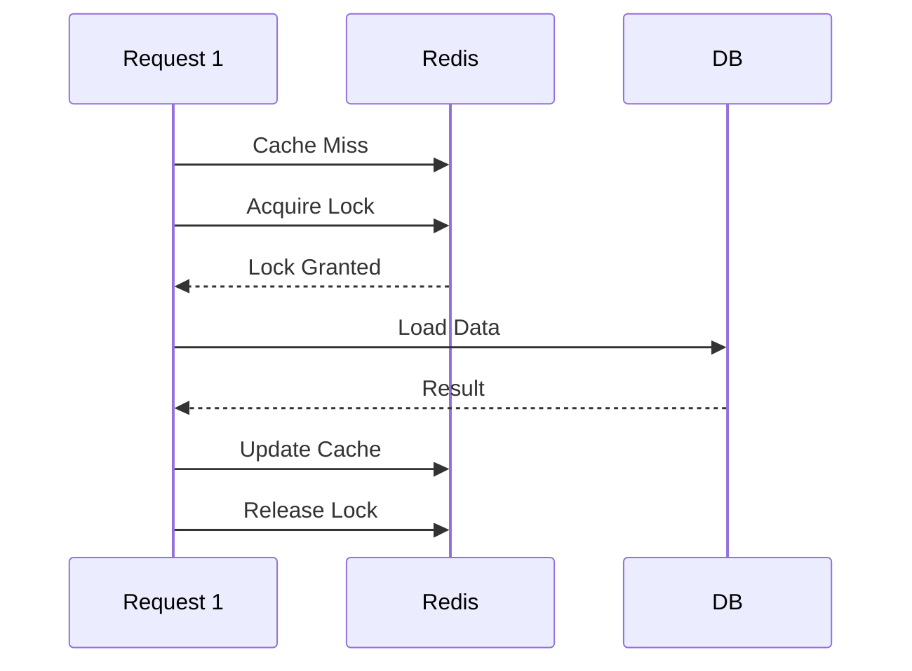
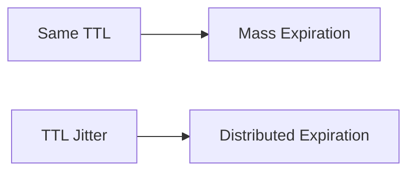

---
tags:
  - redis
  - caching
  - system-design
  - performance
date_created: 2026-06-21
last_modified: 2026-06-21
---

> [!todo] Todo list:
>- [ ] Add Excalidraw diagrams for XFetch probabilities.

# 🐎 The Cache Stampede (Thundering Herd) Problem

## **🧨 Problem Statement**

> [!info] 
> A **Cache Stampede** (also known as the **Thundering Herd** problem) occurs in highly concurrent distributed systems when a highly requested cache key (often called a "Hot Key") expires or is evicted. 

> [!question] What causes a Cache Stampede?
> When the key expires, a massive number of concurrent requests—all expecting to hit the cache—simultaneously experience a "cache miss". In a naive implementation, each of these requests will independently attempt to fetch the missing data from the underlying data source to regenerate the cache. 

**The Result:** The database experiences an instantaneous, massive spike in load. This can lead to database connection pool exhaustion, elevated latency, query timeouts, and cascading system failures. 

![[cache-stampede-hot-key.svg]]

---


## Cache Stampede

The problem where multiple concurrent requests simultaneously find a cache entry expired and then all proceed to try and regenerate the data (usually by calling a slower backend service) is called a **Cache Stampede/Thundering Herd/Dogpile effect**

### A Cache Stampede is dangerous for several reasons:

1. **Backend Overload:** The most immediate danger is the sudden, massive influx of requests to the backend service (in your case, the external market data API). This can **overwhelm** the API, leading to high latency, errors, or even a complete **Denial of Service (DoS)** for that API. Given your system handles 50,000 RPS, even a fraction of those hitting the external API simultaneously could be catastrophic.
2. **Increased Latency:** The system must wait for the external API to respond, causing **high and unpredictable latency** for all the users waiting for the stock quote.
3. **Resource Exhaustion:** Your own application servers might become overloaded as they try to manage thousands of concurrent, long-running requests to the external API, leading to **thread pool exhaustion** or high CPU usage.


## 9 hidden triggers that cause cache stampedes

## 1) TTL alignment (“the midnight cliff”)

If many keys share the same TTL (e.g., 5 minutes) and were written around the same time (deploy, warm-up job, batch import), they can expire in a synchronized wave.

**Real-world example:** A dashboard cache for “top products” is generated during startup and set with `TTL=300s`. Five minutes later, a surge of users lands—boom. Everything expires together.

**Fix:** Add **TTL jitter** (randomization) so expirations spread out.

## 2) Cold starts that wipe local state

Serverless, autoscaling groups, container restarts — these can erase local in-memory caches or per-instance locks you _thought_ were protecting you.

You might be wondering: “But we use Redis.” Sure. But your app might still have a local memoization layer, or a local single-flight lock, or a warmed connection pool that disappears.

**Fix:** Assume restarts happen during peak. Keep stampede protection **distributed** when necessary (or at least resilient to instance churn).

## 3) Hot keys created by “success”

Not all keys are equal. A single key like:

- `homepage:feed`
- `pricing:plans`
- `product:123`
- `search:trending`

…can dominate traffic. When it expires, it’s not “some misses.” It’s _most of your business_.

**Fix:** Identify hot keys by request volume, not by intuition. Treat them differently: longer TTL, SWR, pre-warm, or dedicated refresh jobs.

## 4) Thundering herds from retries and timeouts

When the backend slows down, clients retry. Load balancers retry. SDKs retry. Your own app may retry. Each retry is another “request” participating in the stampede.

That’s how a small miss turns into a catastrophe: the system becomes slower, so it generates _more traffic_, which makes it slower again.

**Fix:** Cap retries, add backoff + jitter, and surface “served stale” instead of retrying into a failing dependency.

## 5) Cache invalidation storms

Sometimes you don’t wait for TTL — you invalidate.

- Content updated? Purge.
- Price changed? Purge.
- Deploy? Purge.
- Incident? Purge everything (we’ve all seen it).

Invalidation can synchronize misses even more aggressively than TTL.

**Fix:** Prefer **versioned keys** (write new key, let old expire) or staged invalidation by segment.

## 6) Eviction pressure and memory fragmentation

Your cache may evict keys early when memory is tight. Under load, the “working set” changes, eviction rises, and suddenly your hot keys aren’t hot in cache anymore.

**Fix:** Monitor eviction rate, memory usage, and key distribution. Consider separating “hot critical” keys into a reserved cache or namespace with different policies.

## 7) Fan-out endpoints hiding behind one key

Some cached values are expensive because they trigger a fan-out: 1 request becomes 30 DB queries or 10 microservice calls.

So when stampede hits, it’s not “N recomputations.” It’s “N * fan-out,” which is how you max out everything at once.

**Fix:** Break apart caches (cache subcomponents), reduce fan-out, and add per-dependency circuit breakers.

## 8) Background refresh jobs that don’t coordinate

Teams add “refresh workers” to precompute values. Good idea… until 20 workers refresh the same hot key because they’re not coordinated or they race after a failure.

**Fix:** Ensure refresh is **idempotent** and coordinated: leader election, single-flight, or distributed lock with a strict timeout.

## 9) Multi-region cache misses and cross-zone latency

If you run multi-region or multi-zone, cross-region cache access can be slow or inconsistent. A region may miss while another is warm, or replication lag causes partial warms.

**Fix:** Design for locality: region-local caches, SWR, and graceful degradation. Don’t let a region cold-start become a global stampede


## Common Mistakes in Cache Implementation

Besides the three strategies above, several **anti-patterns** often make systems fragile:

## 1. Assuming “Using Redis = Problem Solved”

Redis is just **one component** of a caching solution. If:

- Your expiry pattern is wrong,
- TTLs are arbitrary,
- You have no mechanism to prevent stampede,

then you’re only **delaying the problem**, not solving it.

## 2. Arbitrary / Too-Short Cache TTL

TTL that’s too short:

- Forces frequent cache expiry,
- Causes more frequent database hits,
- Increases the risk of cache stampede.

### A More Reasonable Way to Choose TTL

TTL should be:

1. **Longer** than the update frequency of the data  
    (if data changes every 1 minute, don’t cache it for only 10 seconds).
2. **Longer** than the average time required to recompute/refresh the data.
3. **Wider** than typical traffic spike intervals.

Common practice:

- TTL = **3–10×** the average time of the query being cached.

Example:

- The query takes ~200 ms on average.
- TTL of 1–2 seconds is too short (you’ll refresh it constantly).
- A better TTL is several seconds up to minutes, depending on how frequently the data changes.

Additional principle:

- TTL should follow the **cost** and **volatility** of data:
- Expensive-to-compute data → longer TTL,
- Frequently changing data → shorter TTL,
- Always add **jitter** (staggered TTL).

## 3. Using Redlock Everywhere

**Redlock** is a distributed lock algorithm across multiple Redis nodes, designed by Redis’s creator.

Its purpose:

- A lock is considered acquired only if it’s successfully obtained on a **majority** of Redis nodes.
- Suitable for **highly critical** operations that require strong consistency across a multi-node Redis setup.

However:

- It’s **not a silver bullet**.
- It depends heavily on **stable, low-latency network conditions**.

If the network:

- Sometimes has 2 ms latency and sometimes 80 ms,
- Some nodes respond slowly,
- Clients receive lock confirmations late,

then you may experience:

- Locks that appear to fail even though they actually succeeded, or
- Even worse: locks that appear valid even after they’ve effectively expired.

This can become a new source of **inconsistency**.

Recommendations:

- Use Redlock **only for very critical operations**.
- Don’t blindly apply it to every cache refresh.
- Understand your network and Redis cluster characteristics before relying on Redlock.

## 4. Running Heavy Queries Directly on Cache Miss

A common pattern:

- In an API handler:
- Check cache → miss,
- Immediately run a heavy query (joins multiple tables, heavy aggregation),
- Or call an external API with strict rate limits.

Without protection, during a stampede:

- Dozens of instances might simultaneously:
- Execute heavy queries against the database, or
- Hammer an external API until you hit **rate limits**, causing widespread errors.

### Extra Protection for Heavy Queries

At minimum, do three things:

1. **Single-Flight / Mutex Lock**  
    Ensure that only one goroutine/worker runs the heavy query when there is a cache miss.
2. **Fallback to Old Data**  
    If refresh fails or takes too long, use:

- Old data from cache (logical expiration), or
- Another lighter fallback.

**3. Rate Limiting / Token Bucket for External APIs**  
For external services:

- Add a rate limiter or token bucket,
- Make sure your caching mechanism doesn’t cause your system to flood the external API.

## Final Summary

**Cache stampede** is not a minor issue. It’s often the hidden reason behind:

- Sudden database spikes,
- Occasionally weird latency,
- Systems crashing during traffic surges even when business logic seems normal.

Key points to remember:

1. **Redis is not an automatic savior**  
    The patterns you use (TTL, locks, expiry handling, etc.) determine whether your system is **solid or fragile**.
2. Three main strategies to handle cache stampede:

- **Cache with mutex / single-flight**  
    Only one request hits the database to refresh; others wait.
- **Logical expiration**  
    Return old data to users; refresh in the background.
- **Staggered TTL (TTL + jitter)**  
    Spread out expirations to avoid synchronized spikes.

3. Avoid common mistakes:

- Arbitrary or too-short TTLs,
- Blindly relying on Redlock without understanding your network,
- Firing heavy DB queries or external API calls directly on every cache miss with no protection.

Implement these three strategies correctly, and your system will be much more ready to scale and handle high traffic without your monitoring dashboard giving you a heart attack every time traffic climbs.


### 5. Tiered / Multi-Layered Caching 🏗️

Introduce caching at multiple levels:

- **L1 (local in-process)** — fastest, short TTL.
- **L2 (distributed cache like Redis/Memcached)** — medium TTL.
- **CDN/Edge caching** — longer TTLs.

This spreads load and reduces risk of all layers stampeding at once.

### 6. Adaptive Refresh Windows 🧠

Smarter systems track **key popularity**:

- Hot keys = refresh more aggressively (pre-warm before TTL).
- Cold keys = allow natural expiry.

This way, the hottest items never expire “cold” under heavy load.


## **🛡️ Mitigation Strategies**

To prevent a cache stampede without killing system performance, several strategies can be employed:

### **✅ 1. Mutex Locking (The Barrier Approach)**

The most direct way to stop a stampede is to ensure only one thread can rebuild the cache at a time. When a cache miss occurs, the worker must acquire a lock before querying the database.



```java
public byte[] getWithLock(String key, Duration ttl) throws InterruptedException {
    byte[] value = cache.get(key);
    
    if (value != null) {
        return value;
    }

    // Try to acquire a lock for 5 seconds
    String lockKey = key + ":lock";
    boolean acquired = cache.setNX(lockKey, "1", Duration.ofSeconds(5));

    if (acquired) {
        try {
            // Current thread won the race. Fetch and update.
            value = fetchFromDatabase(key);
            cache.set(key, value, ttl);
            return value;
        } finally {
            cache.del(lockKey);
        }
    }

    // Lost the race. Wait and retry reading from cache.
    Thread.sleep(100);
    return getWithLock(key, ttl);
}
```

> [!CAUTION]
> Distributed locks introduce their own failure modes. If the worker holding the lock crashes or times out, you can stall your entire request pipeline. You must set strict, short timeouts on these locks to prevent cascading failures.
> 
> Mutex locking adds latency for all the workers that lose the race, as they sit and poll the cache waiting for the winner to finish. If your database is slow, those waiting threads can balloon your web server’s process count and exhaust memory.

### **✅ 2. Distributed Lock with Stale Fallback (Stale-While-Revalidate)**

When a cache miss occurs, the request must first acquire a distributed lock.
*   **The First Request:** Successfully acquires the lock, queries the database, and repopulates the cache.
*   **Subsequent Requests:** Fail to acquire the lock and must serve stale data.


For truly expensive operations — think **multi-table aggregations** or **external API** calls you’re caching to avoid rate limits — you want only one process across your entire fleet to re-compute at a time.

 Redis-based lock handles this, but the pattern that matters is what you return to everyone else while the lock is held. The stale key is the critical detail. Without it, all the threads that lost the lock race are stuck waiting. With it, they serve a slightly stale response — which for most use cases is far preferable to blocking or returning an error.

> [!note] 
> The tradeoff: this adds two Redis round trips per miss (SetNX + DEL) and stale data semantics.

```java
public byte[] getWithLock(Context ctx, String key) throws Exception {
	byte[] val = cache.get(ctx, key);
    if (val != null) {
        return val;
    }

    String lockKey = "lock:" + key;
    String staleKey = "stale:" + key;

    boolean acquired = cache.setNX(ctx, lockKey, "1", Duration.ofSeconds(10));
    
    if (!acquired) {
        // Another process is recomputing — serve stale if available
        byte[] stale = cache.get(ctx, staleKey);
        if (stale != null) {
            return stale;
        }
        // No stale available — wait and retry
        Thread.sleep(50);
        return cache.get(ctx, key);
    }

    try {
        byte[] value = expensiveRecompute(ctx);
        
        Duration ttl = Duration.ofMinutes(5);
        cache.set(ctx, key, value, ttl);
        cache.set(ctx, staleKey, value, ttl.plusMinutes(2)); // stale survives a bit longer
        return value;
    } finally {
        cache.del(ctx, lockKey);
    }
}
```

>[!CAUTION]
> If your system requires strict freshness, this approach needs explicit cache invalidation rather than TTL-based expiry.

### **✅ 3. Request Coalescing (Single-Flight/Promise Deduplication)**

This strategy works on the application node level by deduplicating concurrent requests for the same key. The most elegant fix is to not prevent cache misses — instead, prevent duplicate in-flight work. 

The root cause of a stampede on a single node is caching the *result* of the fetch instead of the fetch itself. By the time the result exists, the window is already open. The fix is to cache the `CompletableFuture` (the Promise) immediately, before any backend call happens.

> [!info] **Mutex Locking vs. Request Coalescing**
> **Mutex Locking** uses a distributed lock (e.g., in Redis) to ensure only ONE process across the entire cluster can fetch the data. 
> **Request Coalescing** is typically process-local. It ensures that within a single application instance (like a JVM), only one thread fetches the data while others wait for that thread's `CompletableFuture` to resolve. 
> *The Catch:* If you are running 10 pods, each pod independently coalesces, but you still fire 10 database queries per expiry event. For most workloads, this is fine—the reduction is enormous. For extremely hot keys with many replicas, you need a distributed solution (like Mutex Locking).

```java
private final ConcurrentHashMap<String, CompletableFuture<User>> inFlightRequests = new ConcurrentHashMap<>();

public CompletableFuture<User> getUser(Context ctx, String userID) {
    // 1. Check the actual cache first
    User cachedUser = cache.get(ctx, userID);
    if (cachedUser != null) {
        return CompletableFuture.completedFuture(cachedUser);
    }

    // 2. Cache the "Promise" (CompletableFuture) synchronously
    return inFlightRequests.computeIfAbsent(userID, id -> {
        // Only one thread executes this block per key
        return CompletableFuture.supplyAsync(() -> {
            try {
                User user = db.getUser(ctx, id);
                cache.set(ctx, id, user, Duration.ofMinutes(5));
                return user;
            } finally {
                // Remove the promise once the work is done
                inFlightRequests.remove(id);
            }
        });
    });
}
```


```java
private final ConcurrentHashMap<String, CompletableFuture<String>> inflight = new ConcurrentHashMap<>();  
  
public String getCachedValue(String key) {  
    CompletableFuture<String> f = inflight.computeIfAbsent(key, k ->  
        CompletableFuture.supplyAsync(() -> loadFromDatabase(k))  
            .whenComplete((v, ex) -> inflight.remove(k)) // clear on success or failure  
    );  
    String value = f.join();  
    localCache.put(key, value);  
    return value;  
}
```

Now the "Promise" is written synchronously, before any yield happens. Every concurrent caller that comes in after the first one finds the `CompletableFuture` already there and awaits the same result. The fetch fires exactly once (per node) regardless of how many callers are waiting. One fetch. Every caller gets the result. The herd never forms.

This specific technique applies to in-memory caches and process-local deduplication. With Redis or a distributed cache, you’d tackle this differently, typically with a lock (Strategy 1). The underlying problem is identical; only the tool for solving it changes.

### **✅ 4. Probabilistic Early Expiration (XFetch)**

A more elegant approach is to refresh the key _before_ it actually expires, using a probabilistic algorithm. Instead of waiting for the cache TTL to reach zero, requests calculate a probability of triggering a background refresh based on how close the key is to its expiration.

>The **XFetch** algorithm subverts this by probabilistically **re-computing** a key _before_ it expires — with probability inversely proportional to remaining TTL.

As a key approaches expiry, **re-computation probability increases**. By the time TTL hits zero, the value has almost certainly already been refreshed by one lucky early request — quietly, with zero visible latency event.

The standard formula for this is the XFetch algorithm:

$$
-\beta \cdot \delta \cdot \ln(\text{rand}()) > \text{TTL}
$$
Where _delta_ is the delta time it takes to compute the value, and $\beta$ is an aggressive constant greater than 0. For cheap-to-compute, expensive-to-miss keys, this is almost always the right call. Set $\beta$ between 1.0 and 2.0 — higher values push re-computation further from expiry.

> [!Caution]
> This strategy decouples the cache regeneration from the hard expiration time. The tradeoff: you’re doing slightly more re-computation than strictly necessary. _XFetch_ solves the latency problem but adds computational overhead. Running logarithmic math on every hot cache read uses CPU cycles. It also means you are actively refreshing keys that might not actually need to be kept alive, wasting database resources on low-value data if your traffic patterns shift.

```java
static class XFetchEntry {
    public byte[] value;
    public Instant expiresAt;
    public Duration delta; // how long the last recompute took
}

public byte[] xfetchGet(Context ctx, String key, double beta, Supplier<RecomputeResult> recompute) throws Exception {
    byte[] raw = cache.get(ctx, key);
    if (raw != null) {
        XFetchEntry entry = objectMapper.readValue(raw, XFetchEntry.class);
        
        double ttlRemaining = Duration.between(Instant.now(), entry.expiresAt).toMillis() / 1000.0;
        double gap = -beta * (entry.delta.toMillis() / 1000.0) * Math.log(ThreadLocalRandom.current().nextDouble());
        
        if (gap < ttlRemaining) {
            return entry.value; // still fresh, don't recompute yet
        }
        // Probabilistically decided to recompute early (let execution fall through)
    }

    long start = System.nanoTime();
    RecomputeResult result = recompute.get(); // fetch new value
    Duration delta = Duration.ofNanos(System.nanoTime() - start);

    XFetchEntry newEntry = new XFetchEntry();
    newEntry.value = result.value();
    newEntry.expiresAt = Instant.now().plus(result.ttl());
    newEntry.delta = delta;

    byte[] encoded = objectMapper.writeValueAsBytes(newEntry);
    cache.set(ctx, key, encoded, result.ttl());
    
    return result.value();
}
```

### **✅ 5. Background Refresh with Stale-While-Revalidate**

A simpler operational model: never let a cache key expire during request handling. Instead, serve stale values instantly and trigger a background refresh when the key is approaching expiry.

```java
static class RefreshEntry {
    public byte[] value;
    public Instant expiresAt;
    public Instant refreshAt; // before expiresAt
}

public byte[] getWithBackgroundRefresh(Context ctx, String key, Supplier<byte[]> refresh) throws Exception {
    byte[] raw = cache.get(ctx, key);
    if (raw == null) {
        // Cold miss — synchronous recompute, unavoidable
        return synchronousRefresh(ctx, key, refresh);
    }

    RefreshEntry entry = objectMapper.readValue(raw, RefreshEntry.class);

    if (Instant.now().isAfter(entry.refreshAt)) {
        // Stale enough to warrant refresh — do it in the background
        CompletableFuture.runAsync(() -> {
            try {
                // Execute refresh logic
                synchronousRefresh(ctx, key, refresh);
            } catch (Exception e) {
                // Handle exception
            }
        });
    }

    return entry.value; // always return immediately
}
```

P99 latency for warm requests becomes effectively zero — you never block on re-computation. The background thread races ahead and has the new value ready before the next request wave arrives.

> [!CAUTION]
> The tradeoff is thread lifecycle. You should cap background refresh concurrency using a semaphore, worker pool, or dedicated executor; otherwise, a cold restart can spawn thousands of threads simultaneously and overwhelm the system.

### **✅ 6. TTL Jitter**

A simple but highly effective technique to prevent synchronized expirations. You add a random "jitter" to each key's TTL (e.g., `TTL = 3600s + random(0, 300)s`).




###  Adaptive Prefetching

- Detect hot keys dynamically.
- Refresh them **before they expire**.
- Keeps them always “warm.”

---

## **⚖️ Trade-offs Between Strategies**

| Strategy                    | ✅ Pros                                                            | ❌ Cons                                                                                 |
| :-------------------------- | :---------------------------------------------------------------- | :------------------------------------------------------------------------------------- |
| **Lock-Based Regeneration** | Deterministic, strong consistency. Only one DB query is executed. | Lock contention can add latency. Potential for deadlocks.                              |
| **Request Coalescing**      | Very low performance cost. No complex distributed locks needed.   | Only deduplicates requests per node. Does not prevent cluster-wide stampedes entirely. |
| **Probabilistic (XFetch)**  | Near-zero performance penalty. Lowest latency.                    | Complex to tune the probability distribution. Can serve stale data momentarily.        |
| **Background Refresh**      | Zero latency impact on user requests.                             | Can waste resources recomputing data that is never requested.                          |
| **TTL Jitter**              | Zero performance cost. Trivial to implement.                      | Doesn't solve the problem for a single highly popular "Hot Key".                       |

---

## **📝 TL;DR – What to Use When?**

| **Scenario** | **Recommended Approach** |
| :--- | :--- |
| Critical data requiring strong synchronization | **Mutex Locking** |
| High-traffic services with identical concurrent requests per node | **Request Coalescing** |
| Highly dynamic, massive scale systems | **Probabilistic (XFetch)** |
| Dashboards, highly predictable hot keys | **Background Refresh** |
| General reduction of load spikes for bulk items | **TTL Jitter** |

---

## **⚙️ Production Rules for Handling Hot Keys**

When handling extremely popular "Hot Keys" in a production environment, follow these best practices:

**1. Multi-Tiered Caching (Local Cache + Distributed Cache):**
Implement an in-memory local cache (e.g., Caffeine, Guava) on the application instance itself with a very short TTL, backed by a distributed cache. 

**2. Always Fallback to Stale Data (Stale-While-Revalidate):**
Never let user requests hang or fail just because the cache is expired. 

**3. Circuit Breakers and Bulkheads:**
If the cache completely fails, your application should have circuit breakers to prevent the database from being DDOSed.

**4. Combine Jitter with Coalescing/Locking:**
No single strategy is a silver bullet. Use TTL Jitter to prevent mass simultaneous expirations, combined with Request Coalescing.

**5. Set aggressive lock timeouts:**
If you use distributed locks, never let a lock live longer than twice the maximum expected database query time.

## The Code You Can Use Today

Here’s our production-tested cache stampede prevention service that you can adapt:

```java
@Service
public class ProductionCacheService < K, V > {

  private final RedisTemplate < String,
  Object > redisTemplate;
  private final ConcurrentHashMap < String,
  CompletableFuture < V >> ongoingCalculations = new ConcurrentHashMap < > ();
  private final Random random = new Random();
  private final MeterRegistry meterRegistry;

  public CompletableFuture < V > getOrCompute(K key,
    Function < K, V > expensiveCalculation,
    Duration baseTtl) {
    String cacheKey = generateCacheKey(key);

    // Check cache with TTL info
    CacheEntry < V > entry = getCacheEntryWithTtl(cacheKey);

    if (entry != null) {
      // Consider probabilistic refresh
      if (shouldRefreshEarly(entry, baseTtl)) {
        triggerBackgroundRefresh(key, expensiveCalculation, baseTtl);
      }
      return CompletableFuture.completedFuture(entry.getValue());
    }

    // Cache miss - use request coalescing
    return ongoingCalculations.computeIfAbsent(cacheKey, k -> {
      return CompletableFuture.supplyAsync(() -> {
        try {
          // Double-check cache
          CacheEntry < V > rechecked = getCacheEntryWithTtl(cacheKey);
          if (rechecked != null) {
            return rechecked.getValue();
          }

          // Perform expensive calculation
          V result = expensiveCalculation.apply(key);

          // Cache with jitter
          cacheWithJitter(cacheKey, result, baseTtl);

          return result;

        } finally {
          ongoingCalculations.remove(cacheKey);
        }
      });
    });
  }

  private boolean shouldRefreshEarly(CacheEntry < V > entry, Duration baseTtl) {
    long remainingTtl = entry.getRemainingTtlSeconds();

    if (remainingTtl <= 0) return true;

    double refreshProbability = 1.0 - ((double) remainingTtl / baseTtl.getSeconds());
    return random.nextDouble() < refreshProbability;
  }

  private void cacheWithJitter(String key, V value, Duration baseTtl) {
    double jitterFactor = 0.8 + (random.nextDouble() * 0.4);
    Duration jitteredTtl = Duration.ofMillis((long)(baseTtl.toMillis() * jitterFactor));

    redisTemplate.opsForValue().set(key, value, jitteredTtl);
  }

  // Usage example:
  public CompletableFuture < PricingResult > getPricing(String productId, String customerId) {
    PricingKey key = new PricingKey(productId, customerId);

    return getOrCompute(key,
      k -> performExpensiveCalculation(k.getProductId(), k.getCustomerId()),
      Duration.ofMinutes(10));
  }
}
```


## 1. Cache Expiration Is a Distributed Systems Problem

Simple TTL-based expiration doesn’t work at scale. You need:

- Jittered expiration times
- Probabilistic early refresh
- Request coalescing for identical keys

## 2. Monitor Cache Behaviour, Not Just Hit Rates

Traditional cache monitoring focuses on hit rates. What matters more:

- Concurrent calculations for the same key
- Cache refresh patterns
- Time-to-live distributions
- Stampede detection and alerting

## 3. Always Have a Fallback Strategy

Your anti-stampede solution will fail eventually. Plan for:

- Timeout-based fallbacks
- Stale data serving during refresh
- Graceful degradation when cache is unavailable

## 4. Test Cache Invalidation Under Load

We learned this the hard way: test cache expiration scenarios under realistic traffic patterns. Use chaos engineering to simulate:

- Simultaneous cache expiration
- Cache service outages
- Database connection exhaustion
